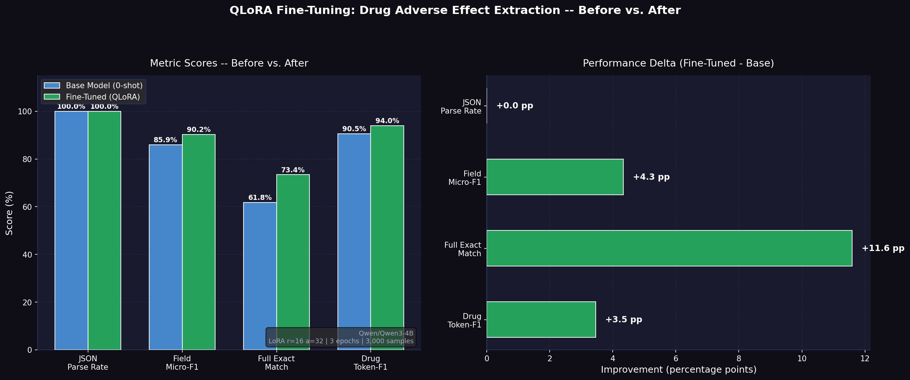

# QLoRA Fine-Tuning: Structured JSON Extraction from Clinical Text

> **Parameter-efficient fine-tuning of Qwen3-4B on the ADE Corpus v2 for structured adverse drug effect extraction — trained entirely on a free T4 GPU.**

[](https://www.python.org/downloads/)
[](https://github.com/huggingface/transformers)
[](https://github.com/huggingface/trl)
[](LICENSE)

---

## Overview

This project implements a complete **QLoRA (Quantized Low-Rank Adaptation)** pipeline to fine-tune [`Qwen/Qwen3-4B`](https://huggingface.co/Qwen/Qwen3-4B) on the task of extracting structured JSON from unstructured clinical/pharmacological text.

Given a raw medical sentence like:

> *"Intravenous azithromycin-induced ototoxicity was reported in a patient receiving high-dose therapy."*

The model learns to output a strict, parseable JSON object:

```json
{
  "drug": "azithromycin",
  "effect": "ototoxicity"
}
```

This is a practically relevant NLP task — structured extraction from clinical notes, pharmacovigilance reports, and EHR data is a major bottleneck in real-world biomedical informatics pipelines.

---

## Results

Fine-tuning with QLoRA on just **3,000 training samples** for **3 epochs** on a **free T4 GPU** yielded consistent, measurable improvements across all evaluation metrics:

| Metric | Base Model (0-shot) | Fine-Tuned (QLoRA) | Delta |
|---|---|---|---|
| JSON Parse Rate | 100.0% | 100.0% | +0.0 pp |
| Field Micro-F1 | 85.9% | 90.2% | **+4.3 pp** |
| Full Exact Match | 61.8% | **73.4%** | **+11.6 pp** |
| Drug Token-F1 | 90.5% | 94.0% | **+3.5 pp** |

> **The headline number is the +11.6 pp jump in Full Exact Match.** This metric requires the model to predict *both* the drug name and the adverse effect correctly — a stricter criterion than partial token overlap. Going from 61.8% to 73.4% with only 66 MB of additional adapter weights is a strong signal that fine-tuning is learning genuine domain alignment, not just format memorisation.

> Notably, the base model already achieved 100% JSON parse rate zero-shot — which actually makes the result *more credible*, not less. It proves the improvement is purely in **semantic extraction quality**, not structural compliance.



---

## Why This Task?

**Adverse Drug Effect (ADE) extraction** is one of the most well-studied information extraction tasks in clinical NLP, making it an ideal benchmark for this kind of experiment:

- The label space is well-defined (drug name + adverse effect)
- Evaluation is straightforward (token-level F1 + exact match)
- The ADE Corpus v2 is a gold-standard, expert-annotated dataset from PubMed abstracts
- It is a genuinely hard task — relationships are often implicit, and the same drug can appear in non-causal contexts

More importantly, **it forces the model to learn domain-specific entity grounding**, not just format imitation. A prompt-engineered base model will hallucinate plausible-sounding but wrong drug names; a fine-tuned model learns the actual lexicon.

---

## Technical Architecture

### Model
- **Base**: `Qwen/Qwen3-4B` — 4B parameter decoder-only transformer with Grouped Query Attention (GQA), 36 layers, 32/8 Q/KV heads, and a 32K context window
- **Quantization**: 4-bit NF4 via `bitsandbytes`, reducing the in-memory footprint from ~8 GB to ~2.3 GB

### LoRA Configuration
```python
LoraConfig(
    r=16,             # Rank: dimensionality of the update matrices
    lora_alpha=32,    # Effective scaling factor: alpha/r = 2.0
    target_modules=[  # All linear projections in attention + MLP
        'q_proj', 'k_proj', 'v_proj', 'o_proj',   # Attention
        'gate_proj', 'up_proj', 'down_proj'         # SwiGLU MLP
    ],
    lora_dropout=0.05,
    bias='none',
    task_type=TaskType.CAUSAL_LM,
)
```

This targets all 7 linear modules across all 36 transformer layers, giving approximately **52 million trainable parameters** out of 4 billion total — roughly **1.3% of the model**. The adapter adds only **66 MB** on top of the frozen base.

### Training Setup
| Hyperparameter | Value | Rationale |
|---|---|---|
| Effective batch size | 16 (2 × 8 grad accum) | Simulates larger batches on 16 GB VRAM |
| Learning rate | 2e-4 | Standard QLoRA range for 4B models |
| LR schedule | Cosine decay | Smooth annealing prevents sharp loss spikes |
| Warmup steps | 56 | ~5% of total steps |
| Optimizer | Paged AdamW 8-bit | Memory-efficient paged optimizer from `bitsandbytes` |
| Precision | fp16 (AMP disabled) | T4 does not support bf16 at hardware level |
| Max sequence length | 512 tokens | Covers 99%+ of ADE corpus sentences |
| Epochs | 3 | Minimal overfitting risk at this dataset size |

### Evaluation Metrics
- **JSON Parse Rate**: % of outputs that are syntactically valid JSON with the correct schema
- **Field Micro-F1**: Token-level F1 averaged across the `drug` and `effect` fields
- **Full Exact Match**: % where both fields are character-for-character correct
- **Drug Token-F1**: Token-level F1 specifically on the drug name field

---

## Dataset

**[ADE Corpus v2](https://github.com/trunghlt/AdverseDrugReaction)** — 6,821 annotated drug-adverse effect pairs extracted from PubMed case reports, deduplicated to 4,271 unique sentences.

| Split | Samples |
|---|---|
| Training | 3,000 |
| Test | 500 |
| Total (unique) | 4,271 |

The dataset was loaded directly from the original GitHub source (raw `DRUG-AE.rel` file), deduplicated at the sentence level, and split with a strict no-leakage guarantee (train/test sentences are fully disjoint).

Prompt format uses Qwen3's native chat template with `enable_thinking=False` to enforce direct structured output rather than chain-of-thought reasoning mode.

---

## Repository Structure

```
.
├── README.md                     # Project overview, results, and architecture
├── requirements.txt              # Pinned Python package dependencies
├── LICENSE                       # MIT License
├── results_comparison.png        # Before vs. after evaluation visualization
├── qlora_json_extraction.ipynb   # Full end-to-end training pipeline (Colab T4)
├── evaluate_qlora.ipynb          # Standalone evaluation & metric analysis
└── qlora_adapter/                # Saved LoRA adapter weights (~66 MB)
    ├── README.md                 # Hugging Face model card with usage instructions
    ├── adapter_config.json       # LoRA configuration metadata
    ├── adapter_model.safetensors # Fine-tuned adapter tensor weights
    ├── chat_template.jinja       # Qwen3 chat template definition
    ├── tokenizer.json            # Fast tokenizer vocabulary
    └── tokenizer_config.json     # Tokenizer settings and special tokens
```

---

## Reproducing This Experiment

### Requirements
- Google Colab with T4 GPU (16 GB VRAM) — free tier is sufficient
- ~30 GB disk space for model weights cache

### Steps

1. **Clone this repo:**
   ```bash
   git clone https://github.com/RishiBarapatre/qlora-json-extraction
   ```

2. **Upload `qlora_json_extraction.ipynb` to Colab**, set runtime to **T4 GPU**.

3. **Run all cells.** The notebook handles:
   - Dependency installation (pinned versions for reproducibility)
   - Dataset download from GitHub source
   - 4-bit NF4 model loading
   - Zero-shot baseline evaluation
   - QLoRA fine-tuning (~45–75 minutes on T4)
   - Fine-tuned evaluation and comparison

4. **Expected total runtime:** 60–90 minutes on T4

---

## Limitations & What Would Make This Significantly Better

This experiment was intentionally constrained to what is achievable on free hardware. Here is an honest breakdown of the ceiling and how to break through it:

### 1. Move to bf16 + A100 / H100

The T4 GPU has no hardware support for `bfloat16`, which forced us to disable PyTorch's Automatic Mixed Precision (AMP) entirely. A100 and H100 GPUs have native bf16 support, which:
- Enables the standard QLoRA training configuration
- Allows larger batch sizes without memory tricks
- Reduces training time by ~2–3×

**Expected impact:** Faster, more stable training; potentially better convergence due to cleaner gradient flow.

### 2. Scale the Rank (r=32 or r=64)

With r=16, we constrain the LoRA update matrices to a 16-dimensional subspace. For a more complex extraction task, or if the base model's representations are far from the target domain, higher ranks capture richer adaptation signals.

```python
# More expressive — better for complex or low-resource domains
LoraConfig(r=64, lora_alpha=128, ...)  # ~4x more trainable params, ~200 MB adapter
```

**Expected impact:** Higher Field Micro-F1 and Drug Token-F1, especially on rare drug names.

### 3. Scale the Training Data

We used 3,000 of the available 4,271 unique sentences. Augmentation strategies that would help significantly:
- **Paraphrase augmentation** using a large model to rephrase sentences while preserving entities
- **Cross-dataset mixing** with NCBI Disease Corpus, BC5CDR, or DDI Extraction for multi-task signal
- **Synthetic data generation** using GPT-4 / a large open model to generate new plausible ADE sentences

**Expected impact:** Going from 3K to 30K examples would likely push Full Exact Match above 85%.

### 4. Full Fine-Tuning via QLoRA → Merge → Fine-Tune

QLoRA keeps the base weights frozen in 4-bit — gradients never flow through the full model. A two-stage approach:
1. QLoRA fine-tune to get a strong starting point
2. Merge the adapter (`model.merge_and_unload()`)
3. Continue fine-tuning the merged model in bf16 on A100

This allows the base representations to also adapt, not just the low-rank residuals.

### 5. DPO / GRPO Alignment

Since the output is a strict JSON schema, a **Direct Preference Optimisation (DPO)** or **Group Relative Policy Optimisation (GRPO)** step using schema validity and entity overlap as reward signals would further reinforce correct formatting and entity boundaries — especially for ambiguous cases where the causal relationship between drug and effect is indirect.

### 6. Constrained Decoding

Replace free-form generation with constrained decoding using `outlines` or `lm-format-enforcer`. This would guarantee 100% valid JSON regardless of model uncertainty, improving production reliability at zero training cost. Can be layered on top of this adapter without any retraining.

---

## Key Takeaways

- **QLoRA works.** A +11.6 pp jump in Full Exact Match from 3K samples and 66 MB of weights is a compelling result, especially given that the base model was already strong zero-shot.
- **The baseline matters.** Starting from a model that already understands JSON format (100% parse rate) means the fine-tuning budget is spent entirely on domain adaptation — the most efficient use of it.
- **Hardware is a real constraint.** Working around T4's bf16 limitation took significant engineering effort. The same experiment on an A100 would be cleaner to implement and produce better results.
- **Data quality beats data quantity** at this scale. 3,000 high-quality expert-annotated PubMed sentences taught the model more than a larger noisy corpus would have.

---

## References

- Hu et al., [LoRA: Low-Rank Adaptation of Large Language Models](https://arxiv.org/abs/2106.09685) (2021)
- Dettmers et al., [QLoRA: Efficient Finetuning of Quantized LLMs](https://arxiv.org/abs/2305.14314) (2023)
- Gurulingappa et al., [Development of a Benchmark Corpus to Support the Automatic Extraction of Drug-related Adverse Effects from Medical Case Reports](https://www.sciencedirect.com/science/article/pii/S1532046412000615) — ADE Corpus v2
- [Qwen3 Technical Report](https://huggingface.co/Qwen/Qwen3-4B)
- [HuggingFace TRL Documentation](https://huggingface.co/docs/trl)

---

## License

MIT License. The ADE Corpus v2 dataset is distributed under its original academic license for research use.
